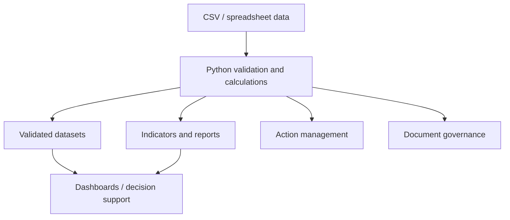

# Industrial Process Engineering Toolkit

An open-source, modular toolkit for industrial process engineering, process management, operational excellence, quality management, engineering documentation, inventory, industrial analytics, and lightweight engineering automation.

The project provides small CSV-first tools and practical guidance for small businesses, engineering teams, university projects, extension teams, laboratories, consultancies, students, and engineering professionals. It is designed to support review and continuous improvement; it is not a certified management system or a substitute for qualified engineering judgment.

## Project Status

This repository is an initial, actively evolving implementation. Status labels distinguish working code from guidance and future work:

- **IMPLEMENTED** — working scripts and supported behavior are present in the repository and tested.
- **DOCUMENTED** — guidance, methodology, or a schema is provided; it does not imply automation.
- **EXAMPLE** — fictional data or a sample structure demonstrating use.
- **PLANNED** — future work with no complete implementation yet.
- **EXPERIMENTAL** — prototype behavior not intended for operational reliance. No experimental feature is currently identified.

Implemented command-line scripts run on Python 3.10+ and use only the Python standard library. Tests use `pytest`. CSV is the primary data interchange format. Example records are fictional.

## Capabilities

| Area | Capability | Status |
|---|---|---|
| Quality / 5S | Audit CSV schema, score validation and average reports by sense and overall | IMPLEMENTED |
| Quality / 5S | Fictional engineering workshop audit | EXAMPLE |
| PDCA | Cycle phases, planning guidance, and header-only cycle template | DOCUMENTED / EXAMPLE |
| 5W2H | Action-planning fields and example traceability from 5S finding via `source_id` | DOCUMENTED / EXAMPLE |
| FMEA | Validate 1–10 ratings, calculate RPN, sort by descending RPN, assign rank | IMPLEMENTED |
| FMEA | Fictional engineering project dataset and header-only template | EXAMPLE |
| Inventory | CSV template and validation of required fields, duplicate IDs, numeric/non-negative quantities, and overdue inspection dates | IMPLEMENTED |
| Document control | Document register, filename convention, revision guidance, and filename/date validator | IMPLEMENTED / DOCUMENTED |
| Engineering project structure | Generate the defined local project directories; supports dry-run | IMPLEMENTED |
| Drive governance | Suggested folder structure, archive, permissions, and onboarding guidance | DOCUMENTED |
| Analytics | Generate supported KPI CSV rows from supplied action, inventory, FMEA, and 5S audit CSVs | IMPLEMENTED |
| Analytics | KPI data dictionary and Power BI page/measure suggestions | DOCUMENTED |
| Standards | Reference indexes, official-source links, and compliance disclaimer | DOCUMENTED |
| Excel workbooks | Workbook generation, formatting, and data validation | PLANNED |
| Power BI | Packaged dashboards and semantic model | PLANNED |
| OEE | Automated OEE calculation | PLANNED |
| Process mapping | Automated process-map generation | PLANNED |

See [ROADMAP.md](ROADMAP.md) for future work. A CSV template or methodology document is not equivalent to a complete automated feature.

## Repository Structure

```text
industrial-process-engineering-toolkit/
├── automation/             # CSV validators, calculations, and generators
├── data-analytics/         # KPI data dictionary and analytics guidance
├── docs/                   # Getting started, architecture, methodology, terminology
├── document-control/       # Register and document naming/revision guidance
├── drive-governance/       # Folder, permission, archive, onboarding guidance
├── examples/               # Fictional 5S, inventory, and FMEA datasets
├── inventory/              # Inventory CSV template and guidance
├── process-management/     # PDCA, 5W2H, KPI, and process templates
├── quality/                # 5S, FMEA, and continuous-improvement guidance
├── standards/              # Reference indexes and official sources
├── tests/                  # Automated tests for implemented behavior
├── .github/workflows/      # GitHub Actions tests
├── README.md
├── ROADMAP.md
├── CONTRIBUTING.md
├── CHANGELOG.md
├── THIRD_PARTY_CREDITS.md
└── LICENSE
```

## Architecture

CSV is currently the main data exchange format. Spreadsheet software can edit CSV files; validation and calculations run locally in Python. Outputs can be reviewed or loaded into a dashboard tool.



The scripts do not upload data to external services. Power BI is optional and no Power BI integration is required to use the implemented tools.

## Quick Start

Requires Python 3.10 or newer. The runtime scripts use only the standard library. Install `pytest` separately if it is not already installed.

From the repository root:

```text
python automation/calculate_fmea.py examples/engineering-project-case/fmea.csv --output fmea-ranked.csv
python automation/validate_inventory.py examples/inventory-case/inventory.csv
python automation/generate_5s_report.py examples/5s-workshop-case/audit.csv --output 5s-scores.csv
python automation/generate_kpis.py --inventory examples/inventory-case/inventory.csv --actions examples/5s-workshop-case/actions.csv --fmea examples/engineering-project-case/fmea.csv --audit examples/5s-workshop-case/audit.csv --output kpis.csv
python -m pytest -q
```

Forward-slash paths work in Python commands on Windows, macOS, and Linux. See [docs/getting-started.md](docs/getting-started.md) and use each script's `--help` for options, including as-of dates, KPI threshold, filename directory, and project root.

## Implemented Automation

| Script | Purpose |
|---|---|
| [`calculate_fmea.py`](automation/calculate_fmea.py) | Requires `severity`, `occurrence`, and `detection` integer values from 1 to 10; calculates RPN, sorts descending, and adds a 1-based risk rank. |
| [`generate_5s_report.py`](automation/generate_5s_report.py) | Validates 5S sense names and 0–5 scores; writes average score and criterion count for each represented sense and an overall average. |
| [`generate_kpis.py`](automation/generate_kpis.py) | Writes KPI rows for provided inputs: open/overdue actions, inventory availability ratio, FMEA records at/above a configurable RPN threshold, and mean 5S score. |
| [`validate_inventory.py`](automation/validate_inventory.py) | Checks required inventory columns/values, duplicate asset IDs, numeric finite non-negative quantities, and overdue inspection dates. |
| [`check_file_names.py`](automation/check_file_names.py) | Recursively checks filenames against the documented project/type/description/revision/date pattern and validates the calendar date. |
| [`generate_project_structure.py`](automation/generate_project_structure.py) | Creates the predefined engineering project directories under a selected root; `--dry-run` prints paths without creating them. |

The scripts report invalid input with a non-zero exit status; they do not silently edit source data. FMEA thresholds and ratings require locally appropriate review.

## Example Datasets

All records in [`examples/`](examples/) are **fictional examples**:

- [`5s-workshop-case/`](examples/5s-workshop-case/) — sample audit, associated 5W2H actions, and header-only PDCA/5W2H templates.
- [`inventory-case/`](examples/inventory-case/) — fictional inventory assets.
- [`engineering-project-case/`](examples/engineering-project-case/) — fictional FMEA records.

> Example data must not be interpreted as real company information, measured industrial performance, certified engineering records, or compliance evidence.

## Testing and Validation

Run the test suite from the repository root:

```text
python -m pytest -q
```

GitHub Actions runs the same command for pushes to the feature branch and pull requests targeting `main`. The tests cover the implemented scoring, validation, ranking, KPI, and structure behavior. Scripts should also be exercised against the fictional datasets when changing their interfaces.

## Engineering Methodology

The toolkit follows this improvement chain:

**Problem → Evidence → Risk → Action → Owner → Deadline → Indicator → Verification → Standardization → Continuous Improvement**

Methods and metrics such as FMEA, 5S, OEE, KPI systems, and process mapping depend on industrial context, governance, data quality, and locally defined criteria. In particular, define FMEA rating scales and escalation rules with qualified stakeholders; an RPN is a prioritization aid, not a universal acceptance threshold. OEE calculation and automated process mapping are not implemented in this version.

## Standards and Compliance

Files in [`standards/`](standards/) are reference indexes and source pointers, not copies of standards. They do not represent certification, legal advice, or an automatic determination of compliance. Confirm current editions, revisions, and applicability with the official sources before use. No protected ABNT, ISO, or regulatory standards text or PDFs are included.

## Documentation

| Resource | Description |
|---|---|
| [Getting started](docs/getting-started.md) | Requirements, commands, and CSV conventions |
| [Architecture](docs/architecture.md) | Data flow and design constraints |
| [Methodology](docs/methodology.md) | Improvement approach, 5S, PDCA, FMEA, and OEE context |
| [Terminology](docs/terminology.md) | Terms used in this repository |
| [Process management](process-management/README.md) | PDCA, 5W2H, process mapping, KPI guidance |
| [Quality](quality/README.md) | Quality module overview |
| [Inventory](inventory/README.md) | Inventory schema and validator behavior |
| [Document control](document-control/README.md) | Register, naming, and revision guidance |
| [Drive governance](drive-governance/README.md) | Suggested engineering file governance |
| [Standards](standards/README.md) | Reference indexes and official sources |
| [Roadmap](ROADMAP.md) | Planned work; not implemented functionality |
| [Changelog](CHANGELOG.md) | Unreleased project changes |
| [Contributing](CONTRIBUTING.md) | Contribution and test guidance |
| [Third-party credits](THIRD_PARTY_CREDITS.md) | Reuse and attribution record |
| [License](LICENSE) | MIT License |

## Authorship, Licensing and Third-Party Integrity

The scripts, templates, documentation, repository structure, and examples included here are presented as project work unless an explicit attribution says otherwise. External references do not imply that their content has been reproduced. Any future reuse of third-party code or materials must have its license verified, required attribution preserved, and source, license, reused component, and modifications recorded in [THIRD_PARTY_CREDITS.md](THIRD_PARTY_CREDITS.md). Protected material must not be copied improperly.

The repository is distributed under the [MIT License](LICENSE). Review the license terms before reuse or redistribution.

## Maintainer

Pedro Henrique Barbosa De Freitas Soares

Mechanical Engineering student — UFTM

GitHub: [@Pedronsjaja](https://github.com/Pedronsjaja)
