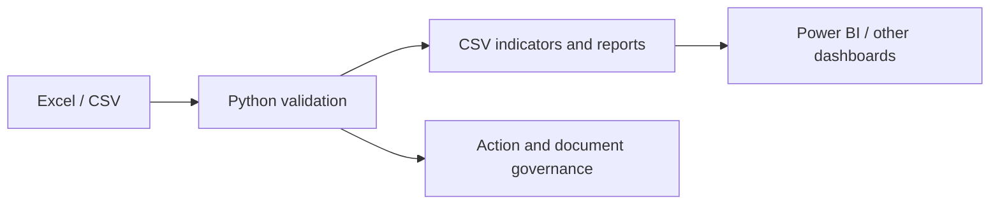

# Industrial Process Engineering Toolkit

An open-source, modular toolkit for process engineering, operational excellence, industrial analytics, and lightweight automation. It is designed for small businesses, engineering teams, university projects, and consultants.

## Project status

This repository is an initial implementation. The Python command-line tools and CSV examples are **IMPLEMENTED**; the datasets are fictional **EXAMPLES**; future integrations and richer templates are **PLANNED**. Nothing here should be treated as a certified management system or as a substitute for competent engineering review.

## Modules

| Area | What is included | Status |
|---|---|---|
| Quality and 5S | 5S audit data model, scoring report, example workshop case | IMPLEMENTED / EXAMPLE |
| PDCA and 5W2H | Methodology and action-planning templates, including 5S action linkage | DOCUMENTED |
| FMEA | CSV scoring, RPN ranking, and risk guidance | IMPLEMENTED |
| Inventory | CSV template and checks for IDs, quantities, required fields, and overdue inspections | IMPLEMENTED |
| Document control | Register, naming/revision guidance, and filename validator | IMPLEMENTED |
| Drive governance | Suggested project folder structure, permissions, archive, and onboarding guidance | DOCUMENTED |
| Analytics | CSV KPI generation and Power BI data dictionary | IMPLEMENTED / DOCUMENTED |
| Standards | Reference indexes and compliance disclaimer | DOCUMENTED |
| Excel and Power BI | CSV-first workflow; optional future workbook/dashboard integrations | PLANNED |

## Architecture



Small, inspectable CSV files are the interchange format. Power BI is optional: validation, calculations, and examples run without it.

## Quick start

Requires Python 3.10 or newer. Runtime scripts use only the Python standard library.

```powershell
python automation\calculate_fmea.py examples\engineering-project-case\fmea.csv --output fmea-ranked.csv
python automation\validate_inventory.py examples\inventory-case\inventory.csv
python automation\generate_5s_report.py examples\5s-workshop-case\audit.csv --output 5s-scores.csv
python automation\generate_kpis.py --inventory examples\inventory-case\inventory.csv --actions examples\5s-workshop-case\actions.csv --fmea examples\engineering-project-case\fmea.csv --output kpis.csv
python -m pytest -q
```

See [Getting started](docs/getting-started.md) for all commands and CSV field definitions.

## Automation

- `calculate_fmea.py`: validates 1-10 ratings, calculates `RPN = Severity × Occurrence × Detection`, and ranks risks.
- `generate_5s_report.py`: calculates average scores by 5S sense and overall score.
- `generate_kpis.py`: creates a concise CSV KPI summary from available action, inventory, and FMEA data.
- `validate_inventory.py`: checks required values, duplicate asset IDs, negative quantities, and overdue inspections.
- `check_file_names.py`: validates names in `PROJECT-TYPE-DESCRIPTION-REVISION-YYYY-MM-DD.ext` format.
- `generate_project_structure.py`: creates the recommended engineering project directory structure.

Scripts accept CSV inputs and report errors to standard error with a non-zero exit code. See the source `--help` output for command details.

## Engineering approach

Use the improvement chain:

**Problem → Evidence → Risk → Action → Owner → Deadline → Indicator → Verification → Standardization → Continuous Improvement**

Methods such as FMEA, OEE, and 5S depend on context and consistent local definitions. Define scoring criteria, evidence requirements, and escalation thresholds with qualified stakeholders before operational use. Never interpret example data as measured business performance.

## Standards and licensing

The indexes in `standards/` are reference aids, not copies of standards and not compliance determinations. Verify current editions and applicability with the official sources listed there. No protected standards text or PDFs are included.

The project is licensed under MIT; see [LICENSE](LICENSE). Third-party inspirations and the scope of any reuse are recorded in [THIRD_PARTY_CREDITS.md](THIRD_PARTY_CREDITS.md). No third-party authorship is claimed.

## Contributing

See [CONTRIBUTING.md](CONTRIBUTING.md). Contributions should include tests for behavior changes, preserve source attribution, and label functionality as IMPLEMENTED, EXAMPLE, PLANNED, or EXPERIMENTAL.

## Roadmap and changes

- [ROADMAP](ROADMAP.md)
- [CHANGELOG](CHANGELOG.md)
- [Architecture](docs/architecture.md)
- [Methodology](docs/methodology.md)
- [Terminology](docs/terminology.md)
