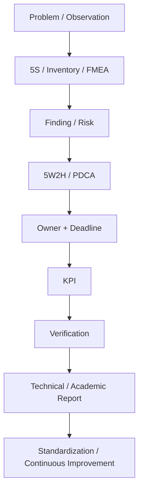
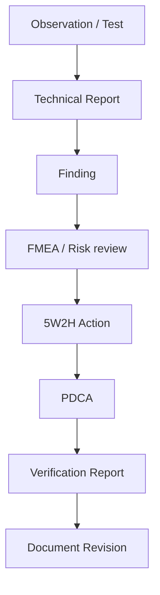

# How the modules connect

These arrows describe a human-led process, not an automated integration. Reports are manual Markdown guidance/templates; existing scripts generate only their documented outputs.

| Module | Responsibility | Handoff |
|---|---|---|
| [5S](../quality/5s/README.md) | Record organization/working-condition observations | audit_id and evidence → action source_id |
| [5W2H](../process-management/5w2h/README.md) | Describe owned, dated actions | action_id → PDCA and verification report |
| [PDCA](../process-management/pdca/README.md) | Plan a change, try it, check it, decide what follows | Verified evidence → revised standard or another cycle |
| [FMEA](../quality/fmea/README.md) | Structure failure-mode review and prioritize discussion | Stable risk reference → action; do not use changing rank as ID |
| [Inventory](../inventory/README.md) | Record assets and inspection dates | asset_id → inspection/test report and KPI |
| [KPI](../process-management/kpi/README.md) | Summarize a defined snapshot | Formula/date/source → interpretation and comparison |
| [Document Control](../document-control/README.md) | Identify reports and their revisions | Register location/reviewer/approval; archive previous revisions |
| [Drive Governance](../drive-governance/README.md) | Organize project files and access responsibilities | Data and report locations → document register |
| [Reports](../reports/README.md) | Explain evidence, analysis, outcomes and decisions | Reviewed findings → actions and retained evidence |

## Traceability without hidden automation
In the tutorial, audit_id AUD-DEMO-001 is copied to action source_id, and action_id ACT-DEMO-001 is referenced in the report. The scripts do not check this relationship, join tables or close findings.
For FMEA, preserve a reviewed stable identifier or file/revision/record reference. The optional risk_id in the tutorial is an extra column, not a required or validated built-in key.

## A test can start the cycle

A test result may need an action without a full FMEA. An inventory review may need no PDCA cycle. Select only the necessary modules; risk and effectiveness decisions belong to the responsible team.

See the [worked tutorial](tutorials/first-improvement-cycle.md) and [five practical routes](common-workflows.md).
